# Sistema de Cobros de Cartera "CrediYa"


Aplicación de consola en Java para gestionar la cartera de créditos de **CrediYa S.A.S.**: empleados, clientes, préstamos, pagos y reportes, con persistencia en **MySQL (JDBC)** y respaldo en **archivos de texto**.

---

## Tabla de contenido

1. [Descripción](#descripción)
2. [Tecnologías](#tecnologías)
3. [Funcionalidades](#funcionalidades)
4. [Arquitectura](#arquitectura)
5. [Estructura del proyecto](#estructura-del-proyecto)
6. [Proceso de desarrollo](#proceso-de-desarrollo)
7. [Diagrama de clases UML](#diagrama-de-clases-uml)
8. [Programa en funcionamiento](#programa-en-funcionamiento)
9. [Reglas de negocio](#reglas-de-negocio)
10. [Validaciones y manejo de errores](#validaciones-y-manejo-de-errores)
11. [Persistencia](#persistencia)
12. [Instalación y ejecución](#instalación-y-ejecución)
13. [Autor](#autor)

---

## Descripción

CrediYa S.A.S. otorga créditos personales y llevaba el control de su cartera en hojas de cálculo. Este sistema digitaliza ese proceso:

- Registra **empleados** y **clientes**.
- Crea **préstamos** asociados a un cliente y a un empleado, calculando automáticamente el **total con interés**, la **cuota mensual** y el **saldo pendiente**.
- Registra **pagos (abonos)** que descuentan el saldo y marcan el préstamo como **PAGADO** al llegar a cero.
- Genera **reportes de cartera**: préstamos activos, vencidos, clientes morosos, búsqueda por estado y resumen general.

El proyecto aplica Programación Orientada a Objetos (herencia, encapsulamiento y polimorfismo), colecciones, archivos, JDBC, excepciones personalizadas, validaciones, Lambda y Stream API, organizado en capas.

---

## Tecnologías

| Tecnología | Uso |
|------------|-----|
| **Java 21+** (probado con JDK 25) | Lenguaje principal |
| **Maven** | Compilación y dependencias |
| **MySQL 8** | Base de datos `crediya_db` |
| **JDBC** (MySQL Connector/J) | Conexión y consultas con `PreparedStatement` |
| **java.nio.file** | Persistencia en archivos `.txt` |
| **Stream API y Lambda** | Filtros, agrupaciones y totales en los reportes |
| **NetBeans** | IDE de desarrollo |

---

## Funcionalidades

| Módulo | Operaciones |
|--------|-------------|
| **Empleados** | Registrar, listar y buscar por ID (rol: ADMINISTRADOR, ASESOR o COBRADOR) |
| **Clientes** | Registrar, listar, buscar por ID y consultar sus préstamos |
| **Préstamos** | Crear (asociado a cliente y empleado), listar, buscar y cambiar estado |
| **Pagos** | Registrar abonos, actualizar el saldo y consultar el historial |
| **Reportes** | Préstamos activos, préstamos vencidos, clientes morosos, búsqueda por estado y resumen de cartera |
| **Archivos** | Respaldo automático en `data/*.txt`; al iniciar se leen y se muestra cuántos registros contienen |

---

## Arquitectura

El sistema está organizado en capas; cada una tiene una única responsabilidad:

```text
           MenuConsola (ui)
                 │
                 ▼
           Service (lógica de negocio) ───► Validador ───► Excepciones
            │                     │
            ▼                     ▼
      DAO (JDBC)            FileManager
            │                     │
            ▼                     ▼
   ConexionBD ─► MySQL       data/*.txt
```

| Paquete | Responsabilidad |
|---------|-----------------|
| `model` | Entidades: `Persona` (abstracta), `Cliente`, `Empleado`, `Prestamo`, `Pago` y los enums `RolEmpleado`, `EstadoPrestamo` |
| `ui` | `MenuConsola`: muestra los menús, lee los datos y es el único lugar donde se capturan las excepciones |
| `service` | Reglas de negocio: `ClienteService`, `EmpleadoService`, `PrestamoService`, `PagoService`, `ReporteService` |
| `dao` | Acceso a MySQL: `ClienteDAO`, `EmpleadoDAO`, `PrestamoDAO`, `PagoDAO` |
| `persistence` | `ConexionBD` (conexión JDBC) y `FileManager` (archivos `.txt`) |
| `validation` | `Validador`: validaciones centralizadas |
| `exception` | `CrediYaException` y sus subclases |

### Conceptos aplicados

- **Herencia**: `Cliente` y `Empleado` extienden la clase abstracta `Persona`.
- **Polimorfismo**: `Persona.mostrarInformacion()` arma los datos comunes y cada subclase lo sobrescribe (`@Override`) agregando los suyos con `super.mostrarInformacion()`. El menú muestra clientes y empleados con un único método que recibe una `Persona`.
- **Encapsulamiento**: atributos privados; `Prestamo` no expone setters de saldo ni de estado, que solo cambian mediante `registrarAbono()` y `cambiarEstado()`.
- **Colecciones**: `List`, `Set` y `Map` (`LinkedHashMap`, `groupingBy`, `toMap`).
- **Lambda y Stream API**: `filter`, `map`, `sorted`, `collect`, `groupingBy`, `summingDouble`, `mapToDouble`, `anyMatch`.
- **Patrones**: arquitectura por capas y DAO.
- **SOLID**: cada clase tiene una sola responsabilidad (SRP) y los servicios reciben por constructor los servicios que necesitan.

---

## Estructura del proyecto

```text
Proyecto_CrediYa_DiazPedro/
├── pom.xml
├── README.md
├── sql/
│   └── crediya_db.sql                 Script de la base de datos
├── data/                              Respaldo en texto (se actualiza automáticamente)
│   ├── empleados.txt
│   ├── clientes.txt
│   ├── prestamos.txt
│   └── pagos.txt
├── docs/
│   ├── capturas/                      Capturas del programa (01 a 13)
│   └── uml/
│       ├── diagrama_clases.drawio     Diagrama editable (draw.io)
│       └── diagrama_clases.png        Diagrama exportado
└── src/main/java/com/mycompanyencapsulamientoprueba/proyecto_crediya_diazpedro/
    ├── Proyecto_CrediYa_DiazPedro.java    Clase principal
    ├── model/
    ├── ui/
    ├── service/
    ├── dao/
    ├── persistence/
    ├── validation/
    └── exception/
```

---

## Proceso de desarrollo

El proyecto se construyó por etapas. Las primeras pruebas validaron la conexión con MySQL y el módulo de clientes.

**1. Prueba de conexión con MySQL.** Primera ejecución de `ConexionBD` desde NetBeans: la conexión JDBC con la base `crediya_db` funciona.

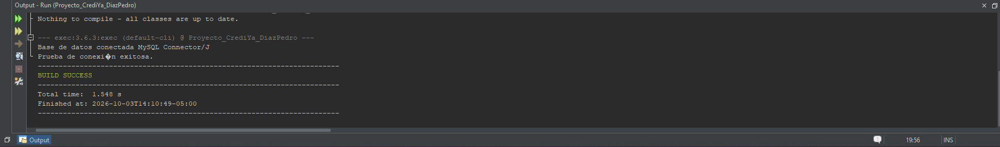

**2. Primer menú de consola.** Primera versión de `MenuConsola`, con el módulo de clientes.

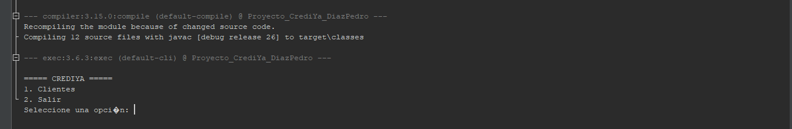

**3. Primer listado de clientes desde MySQL.** El submenú de clientes lista los registros leídos de la base de datos mediante `ClienteDAO`.

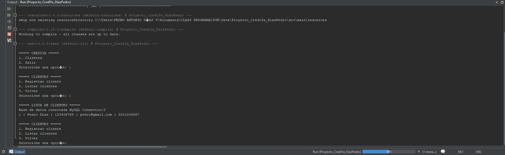

---

## Diagrama de clases UML

Muestra las clases reales del proyecto organizadas por paquete, con sus atributos y métodos principales, la herencia `Persona → Cliente / Empleado`, las asociaciones con cardinalidad (`Cliente 1 — 0..* Prestamo`, `Empleado 1 — 0..* Prestamo`, `Prestamo 1 — 0..* Pago`), los enums y las dependencias entre capas.

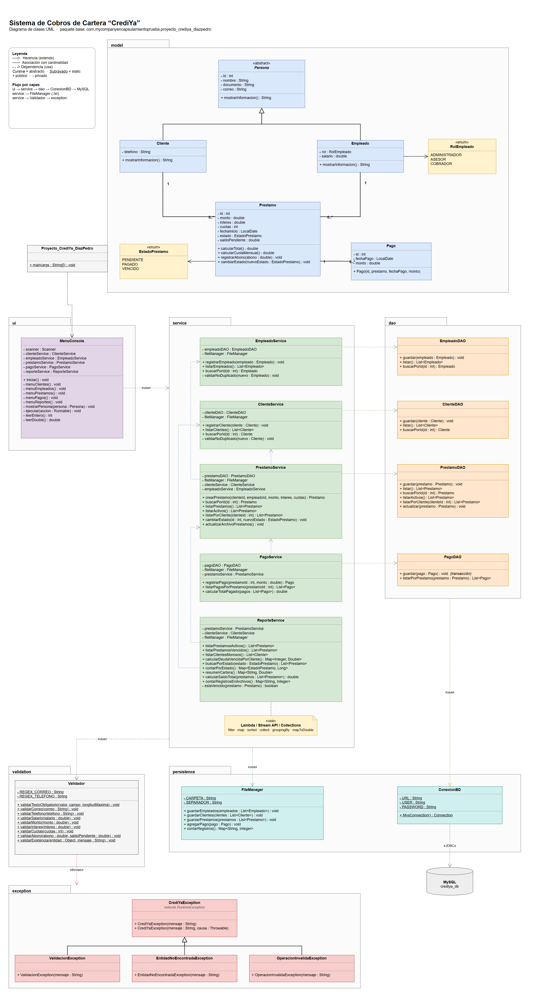

> Archivo editable: [`docs/uml/diagrama_clases.drawio`](docs/uml/diagrama_clases.drawio) (se abre con [draw.io / diagrams.net](https://app.diagrams.net)). Para verlo en tamaño completo, abrir [`docs/uml/diagrama_clases.png`](docs/uml/diagrama_clases.png).

---

## Programa en funcionamiento

Recorrido completo por el sistema, ejecutado desde NetBeans y conectado a MySQL.

### 1. Inicio y clientes

**Inicio del sistema y registro de un cliente.** Al iniciar, el programa lee el respaldo de la carpeta `data` y muestra cuántos registros tiene cada archivo. Luego se registra el cliente *Juan Dario*, que recibe el ID 4, y se listan todos los clientes.

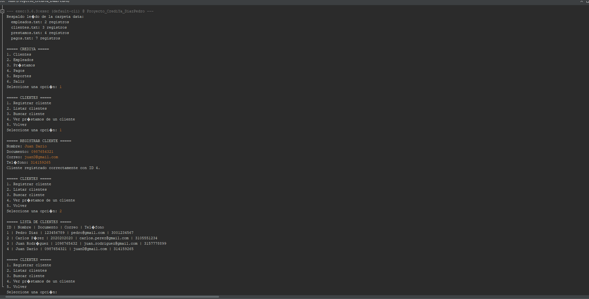

**Búsqueda de un cliente y sus préstamos.** Se busca el cliente 2 (*Carlos Pérez*) y se consultan sus préstamos asociados.

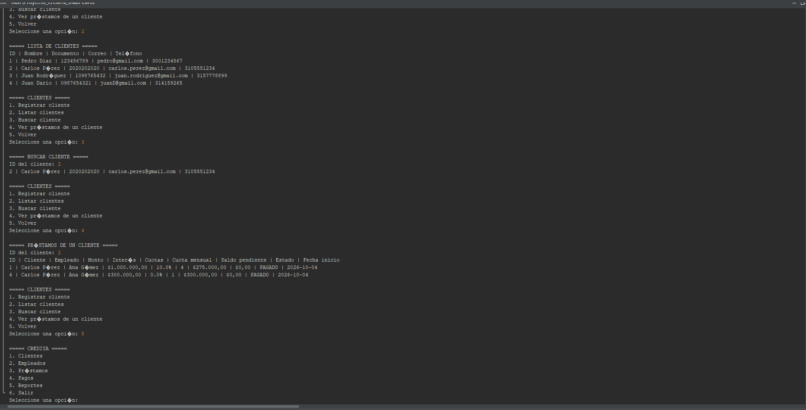

### 2. Empleados

**Registro de un empleado.** Se listan los empleados y se registra a *Carlos Wilches* con rol ADMINISTRADOR y salario de $3.000.000; recibe el ID 3.

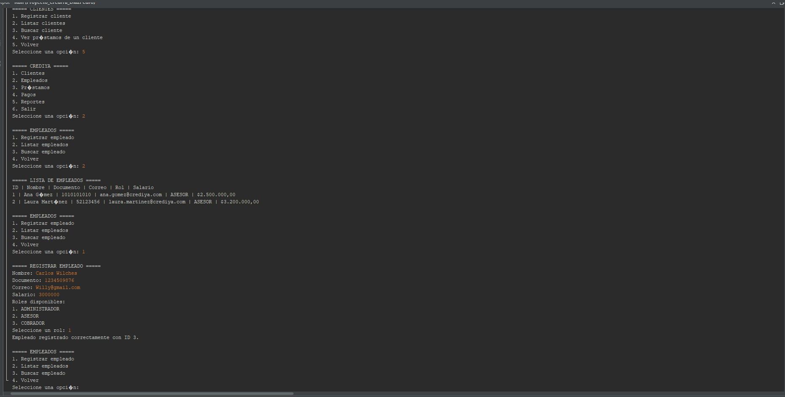

**Listado y búsqueda de empleados.** El listado ya incluye el nuevo empleado y la búsqueda por ID lo encuentra.

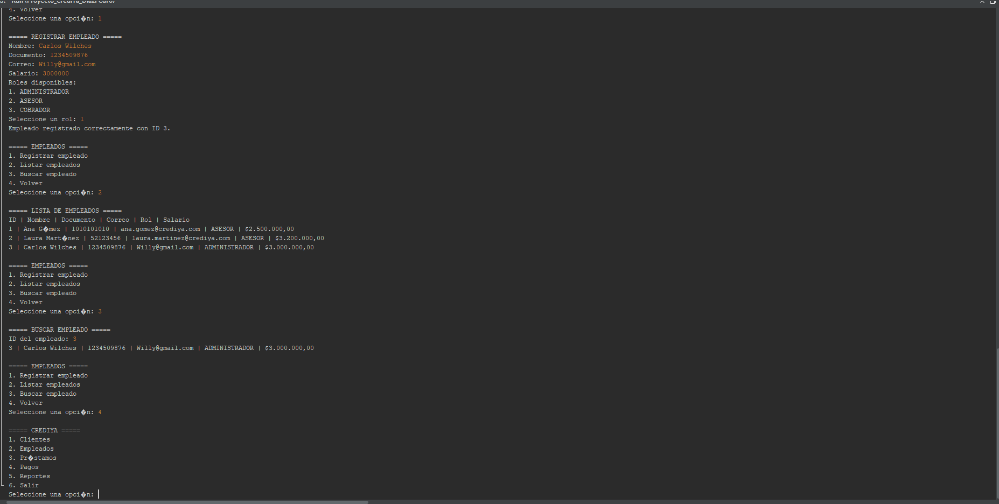

### 3. Préstamos

**Listado y detalle de un préstamo.** Se listan los préstamos con su cuota, saldo y estado, y se consulta el detalle del préstamo 3: total de $525.000, cuota de $262.500 y estado VENCIDO.

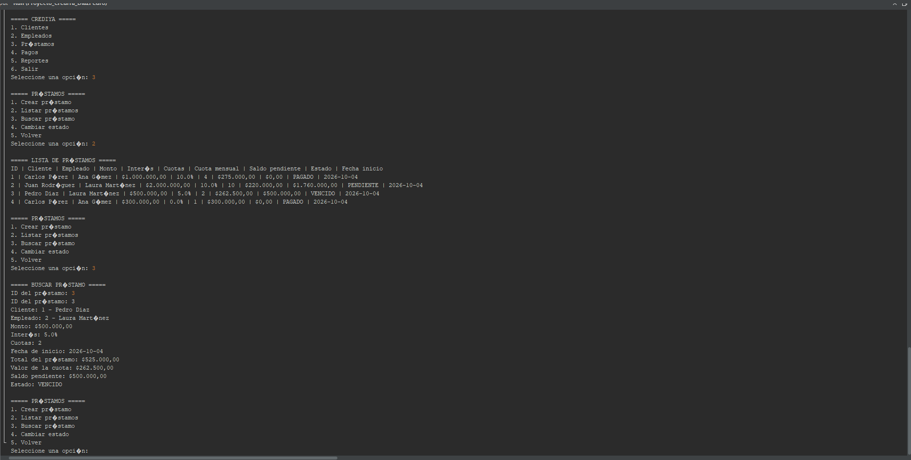

**Creación de un préstamo y cambio de estado.** Se crea el préstamo 5: $1.500.000 al 4 % en 12 cuotas. El sistema calcula automáticamente el **total ($1.560.000)**, la **cuota mensual ($130.000)** y el **saldo pendiente**. Al intentar marcarlo como PAGADO con saldo pendiente, el sistema lo impide con un mensaje claro.

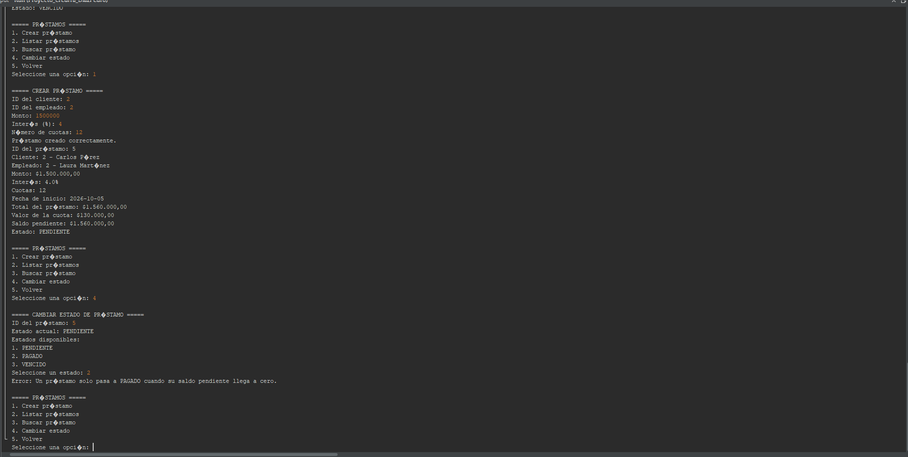

### 4. Pagos

**Historial y pago parcial.** Se consulta el historial del préstamo 2 (dos pagos de $220.000). Luego se registra un abono de $1.500.000 al préstamo 5 y el saldo baja a **$60.000**.

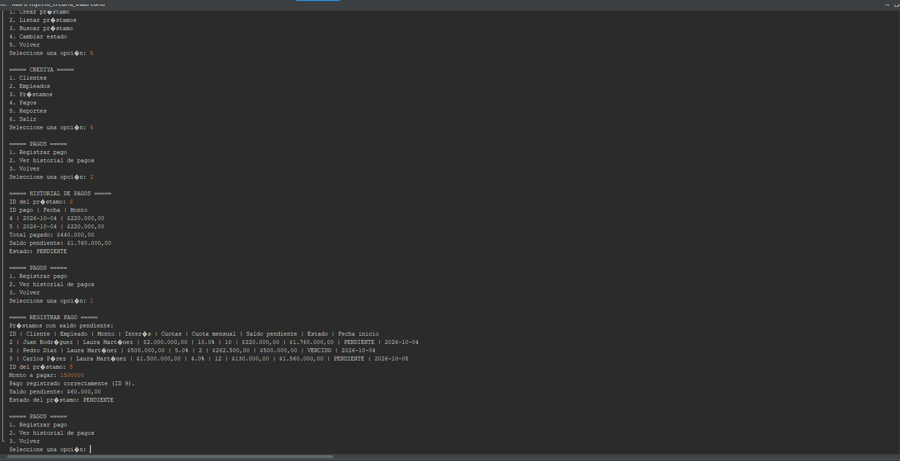

**Pago final.** Con el abono de $60.000 el saldo llega a $0 y el préstamo pasa **automáticamente a PAGADO**.

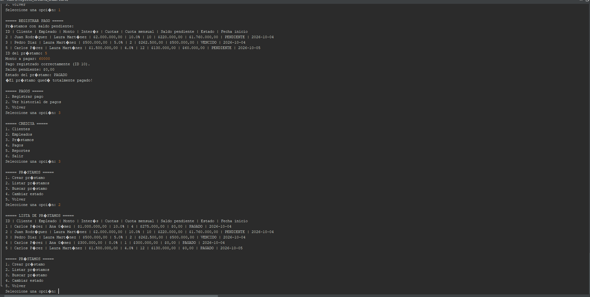

### 5. Reportes (Lambda y Stream API)

**Préstamos activos y vencidos.** Los activos son los que aún tienen saldo por cobrar. El vencido es el préstamo 3, con $500.000 pendientes. Cada reporte muestra la cantidad y el saldo total.

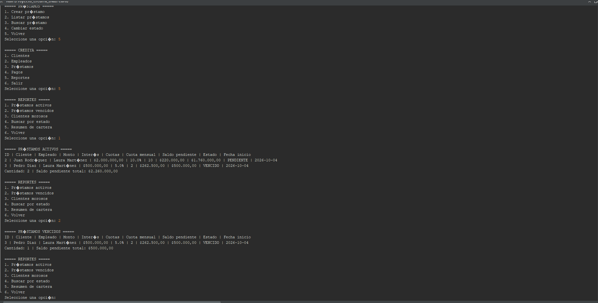

**Clientes morosos, búsqueda por estado y resumen de cartera.** Se identifica al cliente moroso con su deuda vencida, se filtran los préstamos en estado PAGADO y se muestra el resumen: cantidad por estado, total prestado ($5.300.000), total a cobrar ($5.685.000), recaudado ($3.425.000) y saldo por cobrar ($2.260.000).

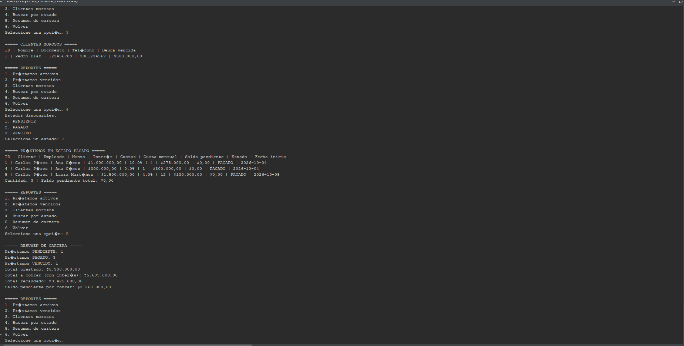

---

## Reglas de negocio

| Concepto | Regla |
|----------|-------|
| Total del préstamo | `monto + (monto × interés / 100)` |
| Cuota mensual | `total / número de cuotas` |
| Préstamo nuevo | Inicia en **PENDIENTE** con saldo pendiente igual al total |
| Abono | Descuenta el saldo; no puede ser negativo ni mayor al saldo pendiente |
| Préstamo pagado | Al llegar el saldo a 0 pasa automáticamente a **PAGADO** y no admite más pagos |
| Cambio de estado manual | Permite marcar **VENCIDO** o volver a **PENDIENTE**; **PAGADO** nunca se asigna a mano |
| Préstamo activo | Tiene saldo por cobrar (estado distinto de PAGADO) |
| Préstamo vencido | Está marcado VENCIDO, o está PENDIENTE y ya pasó su fecha final (inicio + cuotas en meses) |
| Cliente moroso | Tiene al menos un préstamo vencido |

---

## Validaciones y manejo de errores

La clase `Validador` centraliza las validaciones, y cada error lanza una excepción con un mensaje claro:

```text
CrediYaException (RuntimeException)
 ├── ValidacionException           Dato inválido: correo, teléfono, monto, cuotas, interés…
 ├── EntidadNoEncontradaException  Cliente, empleado o préstamo inexistente
 └── OperacionInvalidaException    Regla de negocio violada: pago mayor al saldo, préstamo ya pagado…
```

`MenuConsola` captura las excepciones en un único método (`ejecutar`). Así, **ningún error de entrada cierra el programa**:

| Caso | Respuesta del sistema |
|------|----------------------|
| Texto donde se espera un número | Vuelve a pedir el dato |
| Opción de menú inexistente | "Opción inválida." |
| Correo o teléfono con formato incorrecto | Mensaje de validación |
| Documento o correo duplicado | "Ya existe un cliente registrado con ese documento o correo." |
| Monto negativo, cuotas en 0, interés fuera de 0–100 | Mensaje de validación |
| Cliente, empleado o préstamo inexistente | "No existe un … con ID …" |
| Pago negativo o mayor al saldo | Mensaje con el saldo disponible |
| Pago a un préstamo ya pagado | "El préstamo … ya está pagado." |

---

## Persistencia

### MySQL (JDBC)

- Todas las consultas usan `PreparedStatement` y `try-with-resources`; nunca se concatenan datos del usuario en el SQL.
- `PrestamoDAO` usa `JOIN` para reconstruir cada préstamo con su cliente y su empleado.
- **Registrar un pago es una transacción**: el pago y el nuevo saldo del préstamo se guardan juntos (`commit`), o no se guarda ninguno (`rollback`).

### Archivos de texto

Cada vez que se registra o actualiza información, el servicio guarda en MySQL y actualiza el archivo correspondiente en `data/`. Formato: un registro por línea con campos separados por `|`, y la primera línea describe los campos:

```text
empleados.txt   id|nombre|documento|rol|correo|salario
clientes.txt    id|nombre|documento|correo|telefono
prestamos.txt   id|cliente_id|empleado_id|monto|interes|cuotas|fecha_inicio|estado|saldo_pendiente
pagos.txt       id|prestamo_id|fecha_pago|monto
```

---

## Instalación y ejecución

### Requisitos

- JDK 21 o superior
- Maven (incluido en NetBeans)
- MySQL 8

### 1. Crear la base de datos

Ejecutar el script [`sql/crediya_db.sql`](sql/crediya_db.sql) en MySQL Workbench o en la consola de MySQL. Crea la base `crediya_db` con las tablas `empleados`, `clientes`, `prestamos` y `pagos`, con llaves primarias y foráneas, `NOT NULL`, `UNIQUE` y `CHECK`.

> El script borra y vuelve a crear la base de datos, por lo que elimina los datos existentes.

### 2. Configurar la conexión

Ajustar los campos `URL`, `USER` y `PASSWORD` en `src/main/java/.../persistence/ConexionBD.java` según la instalación local de MySQL. La URL por defecto es:

```text
jdbc:mysql://localhost:3306/crediya_db
```

### 3. Ejecutar

**Desde NetBeans:** abrir el proyecto y usar *Run Project* (F6).

**Desde la terminal**, en la carpeta raíz del proyecto:

```bash
mvn compile org.codehaus.mojo:exec-maven-plugin:3.6.3:java
```

> El programa debe ejecutarse desde la carpeta raíz del proyecto, porque los archivos de respaldo se guardan en `data/`.

---

## Autor

**PEDRO ANTONIO DÍAZ V**

Proyecto académico: Sistema de Cobros de Cartera "CrediYa".
